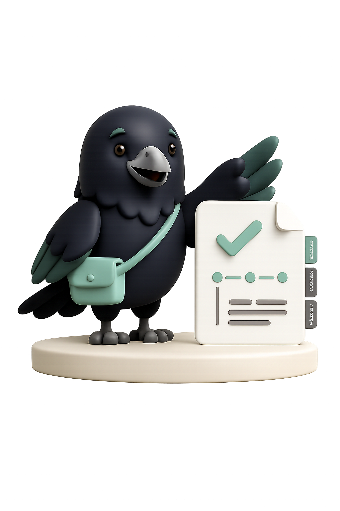

<p align="center">
  
</p>

<h1 align="center">Proofly</h1>

<p align="center">
  <strong>Turn screenshots, photos, notes and documents into a clean, dated proof timeline you can export as a PDF.</strong>
</p>

<p align="center">
  
  
  
  
</p>

---

> [!WARNING]
> **Proofly is no longer active.** The app has been discontinued and is not available for download. Its backend (Supabase project, Edge Functions, storage) and its website `proofly.me` have been shut down, so links in the code such as `proofly.me/sign` and `proofly.me/verify` no longer work.
>
> The code is published as-is so people can read it and learn from it. It is not maintained, and issues and pull requests won't be reviewed.

## What it was

Proofly was an iOS app for people putting together evidence for a real-world dispute, such as a landlord who won't fix a leak, a client who won't pay an invoice, a refund that never arrives, a workplace or school issue, or an insurance claim.

Instead of a camera roll full of screenshots, Proofly let you build a **case**: a timeline of proof items (screenshots, photos, documents, notes and messages), each with a date. You could then export the case as a structured, signed PDF packet to hand to a landlord, a court, an employer or a support team.

The app was **local-first**. Evidence was stored on the device with SwiftData and never uploaded unless you used a feature that needed it (such as asking someone else to sign).

## Features

- **Cases & timelines.** Create a case from a template (apartment issue, unpaid freelance work, refund/warranty, workplace, school, insurance, small claims, and more) and build a chronological timeline of evidence.
- **Evidence inbox & vault.** Import from Photos or Files, triage new items, and keep everything account-scoped on the device.
- **On-device OCR & date extraction.** Apple's Vision framework reads text from screenshots and documents, and a date-candidate extractor suggests when each piece of evidence happened.
- **Case readiness score.** A heuristic score with a "next best step" that tells you what is still missing before the case is ready to export.
- **PDF export.** A PDFKit-generated packet with a cover page, timeline, index, notes, metadata and rendered attachments. Free exports were watermarked.
- **Signatures.** Draw a signature with PencilKit and stamp it anywhere on the generated PDF. The signature has a verification token, a SHA-256 document hash, and a public verification link with a QR code.
- **Ask Sign.** Send the PDF to someone else through a share link or QR code. They sign in the browser, with no app install needed, and both signatures end up in the final PDF.
- **Accounts.** Sign in with Apple, Google, email/password or magic link via Supabase Auth, plus in-app account deletion.
- **Subscriptions.** Free / one-off "urgent export" / Pro tiers via RevenueCat, with entitlements synced server-side through a webhook.
- **Localization.** English and Brazilian Portuguese (pt-BR) via a String Catalog.

An AI-assisted analysis feature (Claude through a Supabase Edge Function proxy, with a credit system) existed for a while but was removed before the project ended. You can still find it in the git history.

## Tech stack

| Layer | Technology |
| --- | --- |
| App | Swift, SwiftUI, SwiftData, Combine |
| Documents | PDFKit, Vision (OCR), PencilKit, QuickLook, CoreImage (QR codes) |
| Backend | Supabase: Postgres with RLS, Auth, Storage, Edge Functions (Deno/TypeScript) |
| Payments | RevenueCat (StoreKit) |
| Analytics | PostHog (privacy-scrubbed events only; no evidence content) |

## Repository layout

```
ProofKit/                  iOS app (internal codename "ProofKit")
├── Models/                SwiftData models: CaseFile, EvidenceItem, Attachment, …
├── Views/                 SwiftUI screens (Home, Cases, Timeline, Export, Paywall, …)
├── ViewModels/
├── Services/              Readiness scoring, date extraction, purchases, analytics, …
├── OCR/                   Vision-based text recognition
├── PDF/                   PDF packet generation and signature stamping
├── Storage/               Local, account-scoped file storage
├── Supabase/              Auth, signature and entitlement API clients
└── Localizable.xcstrings  en + pt-BR strings
ProofKit.xcodeproj/
Config/                    xcconfig files (real keys were never committed)
supabase/
├── migrations/            Postgres schema, RLS policies and RPCs
└── functions/             Edge Functions: signatures, Ask Sign, RevenueCat webhook, account deletion
docs/                      Design notes and implementation write-ups from development
```

## Running it locally

The project builds, but because the backend no longer exists **the app stops at the sign-in screen** unless you point it at your own Supabase project.

1. Install **Xcode 26** or later (the deployment target is iOS 26).
2. Copy the config template and fill in your own values:
   ```bash
   cp Config/ProofKit.local.xcconfig.example Config/ProofKit.local.xcconfig
   ```
3. To get past sign-in, create a Supabase project, apply `supabase/migrations/`, deploy `supabase/functions/`, and set the secrets listed in [`supabase/functions/README.md`](supabase/functions/README.md).
4. RevenueCat and PostHog keys are optional. Without them, purchases and analytics are disabled.
5. Open `ProofKit.xcodeproj`, select the `ProofKit` scheme, and run on a simulator.

## Credits

Built by [@idekrafa](https://github.com/idekrafa) with contributions from [@Intleonard](https://github.com/Intleonard).



The bird you'll find around the app is **Rook**, Proofly's mascot.
<br clear="right">

## License

No open-source license is granted. The code is shared for reference and learning only, and all rights are reserved. If you'd like to reuse part of it, contact [@idekrafa](https://github.com/idekrafa).
