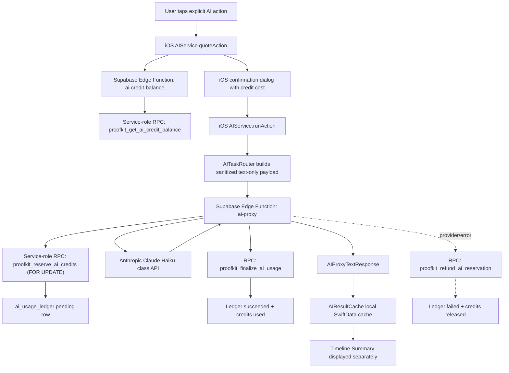

# ProofKit / Proofly AI + Subscription Implementation Documentation

Date: 2026-05-11

Status: first release-ready vertical slice implemented locally; Supabase database migrations applied via Supabase MCP; Edge Functions not deployed yet.

## 1. Executive summary

This document describes the complete AI + subscription implementation slice added to ProofKit/Proofly from the working architecture spec.

The implementation adds:

- subscription/paywall semantics for the current commercial direction:
  - Trial: full Pro non-AI access, `3 AI credits` total during the trial, renews into Weekly Pro
  - Weekly Pro: `$3.99/week`, `15 AI credits/week`
  - Monthly Pro: `$9.99/month`, `75 AI credits/month`, selected by default and marked best value
  - entry offer: free trial that renews into Weekly Pro
- server-authoritative AI credit schema and RPCs in Supabase
- RevenueCat webhook scaffolding for subscription and credit-period sync
- Supabase Edge Functions for AI credit balance/reservation, AI proxying, RevenueCat webhooks, and entitlement compatibility
- Swift AI action models and a quote -> confirm -> run service
- Timeline Summary as the first explicit user-triggered AI action
- privacy protections so AI usage tables do not store OCR text, screenshots, filenames, case titles, notes, prompts, or AI outputs
- preservation of the local-first SwiftData architecture and existing user data

The iOS app still does **not** call Anthropic directly. AI requests go through Supabase Edge Functions, where credits are reserved/finalized/refunded server-side.

## 2. Implementation status

### Completed in this slice

- Paywall copy no longer presents a permanent free plan.
- Weekly trial and renewal copy now appears in the paywall flow.
- Monthly Pro remains the default selected plan and best-value plan.
- App-side subscription status model now distinguishes:
  - `trialing`
  - `active_weekly`
  - `active_monthly`
  - `expired`
  - `cancelled`
  - `billing_retry`
  - `revoked_or_refunded`
- AI features are modeled with `AIActionKind` and `AIUsageQuote`.
- `AIService` supports quote -> confirm -> run for case-level AI actions.
- Timeline Summary is available from the Timeline screen behind an explicit user tap and credit confirmation.
- AI output is cached in the existing `AIResultCache` model and remains separate from original evidence/OCR/user notes.
- Supabase migration defines subscription, balance, pricing, and usage-ledger tables.
- Supabase RPCs provide atomic credit reservation/finalization/refund.
- Supabase Edge Functions scaffold the server-side AI and RevenueCat flows.

### Not completed / intentionally deferred

- Remote Supabase database migrations were applied to project `zvwixgdclmrhopsbuqld` via Supabase MCP on May 11, 2026.
- Edge Functions were added to the repo but not deployed remotely in this change.
- Packet Polish and Deep Review are priced/configured in backend schema, but UI entry points are not enabled in this slice.
- Ask AI remains disabled in seeded pricing and has no UI entry point.
- Full server-side case ownership verification is limited because cases are currently local-only SwiftData records and are not mirrored to Supabase.

## 3. High-level architecture



## 4. Product and commercial rules implemented

### Plans

| Plan | Price | AI credits | Notes |
| --- | ---: | ---: | --- |
| Trial | Free during 3-day App Store trial period | `3 total during trial` | Full Pro non-AI access; renews into Weekly Pro. |
| Weekly Pro | `$3.99/week` | `15/week` | Trial entry offer renews into this plan. |
| Monthly Pro | `$9.99/month` | `75/month` | Default selected plan; marked best value. |

### Paywall rules

The paywall now follows these rules:

- Use wording like `Start your free trial`, `Full Pro access during trial, including unlimited cases, unlimited proof, clean exports, and 3 AI credits`, `Then $3.99/week after trial`, and `Cancel anytime before the trial ends`.
- Do not say `Free forever`, `Free plan`, `Unlimited AI`, or `AI included without limits`.
- State the renewal price and credit allowance clearly.
- Explain billing timing:
  - Weekly: billing starts when the 3-day trial ends.
  - Monthly: monthly billing applies, and if the App Store offers a trial, billing starts when that trial ends.

### AI product rules

- Local OCR remains free.
- AI usage is credit-based and server-authoritative.
- AI never runs automatically.
- AI output remains separate from original evidence/OCR/user-authored content.
- Raw files stay on device.
- The app sends only compressed text and sanitized metadata to the AI proxy.
- Anthropic is called only from Supabase Edge Functions.

## 5. Swift implementation details

### 5.1 New file

`ProofKit/AI/AIService.swift`

Adds:

- `AIActionServicing`
- `AIService`

Responsibilities:

- call `paywall.canUseAI()` before AI actions
- fetch server credit balance
- build an `AIUsageQuote`
- reject insufficient-credit actions before the user confirms
- run supported case-level AI actions through `AITaskRouter`

Supported in this slice:

- `timelineSummary`
- `packetPolish` is service-recognized but no UI entry point was added

Unsupported for now:

- `deepReview`
- `askAIShort`
- `askAICase`

### 5.2 AI action model

`ProofKit/Supabase/SupabaseInfrastructureModels.swift`

Adds:

- `AIActionKind`
- `AIUsageQuote`

`AIActionKind` values:

| App action | Backend feature | Default credits | Notes |
| --- | --- | ---: | --- |
| `timelineSummary` | `timeline_summary` | 2 | First implemented UI action. |
| `packetPolish` | `packet_polish` | 4 | Backend priced; UI deferred. |
| `deepReview` | `deep_review` | 10 | Backend priced; UI deferred. |
| `askAIShort` | `ask_ai_short` | 1 | Seeded disabled in backend pricing. |
| `askAICase` | `ask_ai_case` | 3 | Seeded disabled in backend pricing. |
| `rewriteNote` | `rewrite_note` | 1 | Existing cleanup path compatibility. |

### 5.3 Service container wiring

`ProofKit/Services/ServiceContainer.swift`

Adds `aiActions` to the service container and wires it to:

- `SupabaseInfrastructureService` for credit balance/reservation support
- `PlaceholderPaywallService` for entitlement gating
- `AITaskRouter` for text-only AI routing

### 5.4 Timeline Summary UI

`ProofKit/Views/TimelineView.swift`

Adds an AI panel above the timeline toolbar when a case has timeline items.

Behavior:

1. User taps `Summarize timeline with AI`.
2. App checks current entitlement and credit balance.
3. App shows a confirmation dialog with:
   - feature name
   - credit cost
   - current credits
   - projected remaining credits
   - estimated wait message
4. User explicitly confirms credit usage.
5. App calls `AIService.runAction(.timelineSummary, ...)`.
6. The result is shown in the AI panel.
7. Result is cached in `AIResultCache` through the existing router/cache flow.

Important UI copy:

- says AI never changes original proof/OCR/notes
- says local OCR/timeline editing/exports do not use AI credits
- distinguishes restored local cache from new AI output

### 5.5 AI routing/privacy hardening

`ProofKit/AI/AITaskRouter.swift`

Changed:

- removed attachment filenames from AI metadata and AI prompt labels
- kept attachment type and file-size style metadata only
- AI prompt payload remains compressed text-only with non-sensitive metadata

`ProofKit/Supabase/SupabaseInfrastructureService.swift`

Changed:

- rejects metadata keys containing filename/path/file URL/image/PDF/thumbnail style values before invoking the AI proxy

### 5.6 Subscription/paywall Swift changes

Files:

- `ProofKit/Models/ProofKitPlan.swift`
- `ProofKit/Services/PurchaseManager.swift`
- `ProofKit/Services/PaywallService.swift`
- `ProofKit/Services/RevenueCatSubscriptionService.swift`
- `ProofKit/Views/PaywallView.swift`
- `ProofKit/Views/PaywallPlanCard.swift`
- `ProofKit/Views/AICreditStatusCard.swift`
- `ProofKit/Views/GlobalSettingsView.swift`
- `ProofKit/Views/ExportPreviewView.swift`

Key behavior:

- `ProofKitSubscriptionStatus` models lifecycle states.
- `ProofKitEntitlementSnapshot` now carries subscription product/status context.
- Trialing Pro returns `3` included AI credits.
- Weekly Pro returns `15` included AI credits.
- Monthly Pro returns `75` included AI credits.
- No-active-Pro state returns `0` AI credits.
- AI gating checks current entitlement and included credits.
- RevenueCat snapshot maps active products/period type into ProofKit subscription product/status.
- Trial period from RevenueCat is reflected as `trialing` when available.

### 5.7 Configuration changes

`Config/ProofKit.local.xcconfig.example`

Adds placeholders for:

- `PROOFKIT_SUPABASE_PROJECT_REF`
- `PROOFKIT_SUPABASE_AUTH_REDIRECT_URL`

No keys or secrets were added to tracked config.

## 6. Supabase database implementation

Migration:

`supabase/migrations/20260511210352_20260511120000_ai_subscription_architecture.sql`

### 6.1 Tables

#### `subscription_accounts`

Purpose: server-side entitlement snapshot derived from RevenueCat/webhooks.

Important fields:

- `user_id`
- `provider`
- `provider_customer_id`
- `entitlement_id`
- `plan`
- `status`
- `current_period_start`
- `current_period_end`
- `trial_ends_at`
- `renews_into_plan`
- `ai_credit_allowance`
- `unlimited_cases`
- `source_event_id`

Allowed plans:

- `trial_weekly_intro`
- `weekly_pro`
- `monthly_pro`
- `none`

Allowed statuses:

- `trialing`
- `active_weekly`
- `active_monthly`
- `expired`
- `cancelled`
- `billing_retry`
- `revoked_or_refunded`

#### `ai_credit_balances`

Purpose: current period AI credit balance.

Important fields:

- `user_id`
- `subscription_account_id`
- `period_start`
- `period_end`
- `credits_granted`
- `credits_reserved`
- `credits_used`
- `credits_remaining` generated column

The generated balance is:

```sql
credits_granted - credits_reserved - credits_used
```

The table has checks to prevent negative balances and invalid periods.

#### `ai_usage_ledger`

Purpose: append-only-style audit/usage ledger.

Important fields:

- `user_id`
- `case_id`
- `feature`
- `provider`
- `model`
- `status`
- `credits_reserved`
- `credits_charged`
- `input_tokens`
- `output_tokens`
- `estimated_cost_usd`
- `actual_cost_usd`
- `request_hash`
- `response_hash`
- `idempotency_key`
- `error_code`
- `reservation_expires_at`

Privacy guarantee: this table is for metadata, accounting, and hashes only. It must not store OCR text, screenshots, filenames, case titles, notes, prompts, or AI outputs.

#### `ai_feature_pricing`

Purpose: server-configurable credit costs and token caps.

Seeded rows:

| Feature | Credits | Tier | Input cap | Output cap | Enabled |
| --- | ---: | --- | ---: | ---: | --- |
| `timeline_summary` | 2 | `haiku` | 12000 | 1200 | yes |
| `packet_polish` | 4 | `haiku` | 20000 | 1800 | yes |
| `deep_review` | 10 | `haiku` | 60000 | 2500 | yes |
| `ask_ai_short` | 1 | `haiku` | 3000 | 800 | no |
| `ask_ai_case` | 3 | `haiku` | 10000 | 1000 | no |
| `rewrite_note` | 1 | `haiku` | 3000 | 800 | yes |

### 6.2 RLS policies

Enabled on:

- `subscription_accounts`
- `ai_credit_balances`
- `ai_usage_ledger`
- `ai_feature_pricing`

User-facing read policies:

- users can read their own subscription account rows
- users can read their own credit balance
- users can read their own usage ledger rows
- authenticated users can read feature pricing

Writes are intended for service role and RPC/Edge Function flows only.

### 6.3 RPCs

#### `proofkit_get_ai_credit_balance(p_user_id)`

Service-role-only balance lookup. Edge Functions authenticate the caller first, then pass the verified Supabase user id:

- available credits
- reserved credits
- included credits
- renewal date
- updated timestamp

#### `proofkit_reserve_ai_credits(p_user_id, p_feature, p_case_id, p_idempotency_key)`

Atomic reservation flow:

1. requires a service-role caller to pass a verified user id
2. checks feature is enabled
3. applies a simple per-user recent-request rate limit
4. handles idempotency key reuse
5. verifies an active/trialing entitlement
6. locks the user's balance row with `FOR UPDATE`
7. verifies enough credits
8. increments `credits_reserved`
9. inserts a pending ledger row
10. returns ledger id, reserved credits, remaining balance, and reservation expiry

#### `proofkit_finalize_ai_usage(...)`

Service-role-only finalization flow:

1. locks ledger row
2. ignores already-finalized rows
3. moves reserved credits to used credits
4. records token counts, model, cost estimates, request/response hashes
5. marks ledger `succeeded`

#### `proofkit_refund_ai_reservation(...)`

Service-role-only failure flow:

1. locks ledger row
2. ignores already-finalized rows
3. releases reserved credits
4. records error code
5. marks ledger `failed`

#### `proofkit_sync_subscription_account(...)`

Service-role-only RevenueCat sync flow:

1. upserts the user's subscription account
2. maps plan/status into credit allowance
3. resets or preserves credit period usage depending on period changes
4. zeroes credits for expired/billing retry/revoked/refunded states

## 7. Supabase Edge Functions

Directory:

`supabase/functions/`

### 7.1 Shared helpers

`supabase/functions/_shared/cors.ts`

- CORS headers
- JSON response helper

`supabase/functions/_shared/supabase.ts`

- environment validation
- authenticated user client
- service-role admin client
- authenticated user requirement helper

`supabase/functions/_shared/ai.ts`

- AI feature normalization
- safe string handling
- metadata sanitization
- prompt construction
- system prompts
- SHA-256 hashing
- optional cost estimate helper

### 7.2 `ai-credit-balance`

File:

`supabase/functions/ai-credit-balance/index.ts`

Responsibilities:

- require authenticated Supabase user
- call service-role-only `proofkit_get_ai_credit_balance` with the verified user id
- return app-compatible camelCase JSON:
  - `availableCredits`
  - `reservedCredits`
  - `includedMonthlyCredits`
  - `renewsAt`
  - `updatedAt`

### 7.3 `ai-credit-reserve`

File:

`supabase/functions/ai-credit-reserve/index.ts`

Responsibilities:

- require authenticated Supabase user
- normalize feature/task name
- call service-role-only `proofkit_reserve_ai_credits` with the verified user id
- return app-compatible reservation JSON:
  - `reservationID`
  - `creditsReserved`
  - `remainingCredits`
  - `expiresAt`

### 7.4 `ai-proxy`

File:

`supabase/functions/ai-proxy/index.ts`

Responsibilities:

1. require authenticated Supabase user
2. require `userTriggered == true`
3. normalize feature
4. validate compressed text input
5. load enabled feature pricing
6. reserve credits through service-role-only `proofkit_reserve_ai_credits`
7. call Anthropic with a Haiku-class model
8. extract text output
9. hash request and response
10. finalize usage through `proofkit_finalize_ai_usage`
11. return app-compatible `AIProxyTextResponse`
12. refund reserved credits on provider/config/output failure

The function intentionally does not accept images, PDFs, local paths, or file bytes.

### 7.5 `purchase-entitlements`

File:

`supabase/functions/purchase-entitlements/index.ts`

Responsibilities:

- compatibility bridge for existing app entitlement fallback
- authenticates the user, then reads that user's `subscription_accounts` rows with the service-role Edge Function client
- returns `PurchaseEntitlementRecord`-compatible rows

### 7.6 `revenuecat-webhook`

File:

`supabase/functions/revenuecat-webhook/index.ts`

Responsibilities:

- accepts RevenueCat webhook payloads
- optionally verifies `REVENUECAT_WEBHOOK_AUTHORIZATION`
- lets RevenueCat dashboard `TEST` webhooks succeed without a Supabase user UUID
- extracts a UUID app user id from `app_user_id`, `original_app_user_id`, or aliases
- maps RevenueCat event/product/period into ProofKit plan and status without revoking access before a subscription expiration event
- calls `proofkit_sync_subscription_account`

Deployment note: deploy `revenuecat-webhook` with Supabase JWT verification disabled because RevenueCat sends its own Authorization header, not a Supabase user JWT. Keep `REVENUECAT_WEBHOOK_AUTHORIZATION` set as the function-level shared secret.

Plan mapping:

- trial period -> `trial_weekly_intro`
- product id containing `monthly`/`month` -> `monthly_pro`
- product id containing `weekly`/`week` -> `weekly_pro`
- otherwise -> `none`

Status mapping:

- trial period -> `trialing`
- weekly plan -> `active_weekly`
- monthly plan -> `active_monthly`
- expiration events -> `expired`
- billing issue or voluntary cancellation events keep active access while the current paid/grace period is still valid
- refund/customer-support/developer-initiated cancellation events -> `revoked_or_refunded`
- cancellation events -> `cancelled`
- billing events -> `billing_retry`
- refund/revocation signals -> `revoked_or_refunded`

## 8. Required backend secrets and environment

Do not commit these values to source.

Required Supabase Edge Function secrets:

- `SUPABASE_URL`
- `SUPABASE_ANON_KEY`
- `SUPABASE_SERVICE_ROLE_KEY`
- `ANTHROPIC_API_KEY`
- `REVENUECAT_WEBHOOK_AUTHORIZATION` recommended

Optional:

- `PROOFKIT_ANTHROPIC_HAIKU_MODEL`
- `PROOFKIT_AI_INPUT_COST_PER_MILLION_USD`
- `PROOFKIT_AI_OUTPUT_COST_PER_MILLION_USD`

Required iOS/local config placeholders:

- `PROOFKIT_SUPABASE_PUBLISHABLE_KEY`
- `PROOFKIT_SUPABASE_PROJECT_REF` or `PROOFKIT_SUPABASE_URL`
- `PROOFKIT_SUPABASE_AUTH_REDIRECT_URL`
- `PROOFKIT_REVENUECAT_API_KEY`

## 9. Deployment checklist

### 9.1 Apply database migrations

The database migrations have been applied to Supabase project `zvwixgdclmrhopsbuqld` via Supabase MCP.

Applied migration intent:

- `20260511210352_20260511120000_ai_subscription_architecture.sql` — subscription/AI credit tables, RLS, pricing seed rows, and RPCs.
- `20260511210619_20260511211500_harden_ai_rpc_privileges.sql` — explicit RPC `EXECUTE` grant hardening.
- `20260511211007_20260511213000_make_ai_rpcs_service_only.sql` — balance/reservation RPCs moved behind service-role Edge Function calls.
- `20260511211008_20260511214000_optimize_profiles_rls_and_ai_indexes.sql` — RLS performance cleanup and missing FK index.

Current CLI reconciliation after MCP apply:

```sh
supabase migration list --linked
supabase db push --dry-run --linked
```

- local and remote migration versions match
- dry-run reports `Remote database is up to date`

For future CLI-based environments, apply pending local migrations with:

```sh
supabase db push --linked
```

### 9.2 Configure Supabase Edge Function secrets

Set secrets through Supabase secret management. Use real values only in the secret store, never in source.

Recommended approach:

1. Put real values in an ignored local env file or in the Supabase dashboard secret editor.
2. Use `supabase secrets set --env-file <ignored-env-file>` or the dashboard to upload them.
3. Never paste real secret values into tracked docs, Swift files, SQL files, build logs, or examples.

### 9.3 Deploy functions

```sh
supabase functions deploy ai-credit-balance
supabase functions deploy ai-credit-reserve
supabase functions deploy ai-proxy
supabase functions deploy purchase-entitlements
supabase functions deploy revenuecat-webhook
```

### 9.4 Configure RevenueCat

RevenueCat should be configured so:

- app user id equals the Supabase auth user UUID when signed in
- Weekly Pro product id matches or contains `weekly`/`week`
- Monthly Pro product id matches or contains `monthly`/`month`
- Pro entitlement id is one of the app-recognized ids:
  - `pro`
  - `proofkit_pro`
  - `ProofKit Pro`
- webhook sends to the deployed `revenuecat-webhook` function URL
- webhook authorization header matches `REVENUECAT_WEBHOOK_AUTHORIZATION`

## 10. Privacy and security model

### 10.1 What may be stored in usage/account tables

Allowed:

- user UUID
- local case UUID as an opaque id
- feature name
- provider/model identifiers
- ledger status
- credits reserved/charged
- token counts
- cost estimates
- request/response hashes
- generic error codes
- timestamps

### 10.2 What must not be stored in usage/account tables

Never store:

- raw OCR text
- screenshots
- image/PDF/document bytes
- filenames
- case titles
- user notes
- prompt bodies
- AI outputs
- local file paths
- exported packet contents
- raw email/name in analytics/usage ledger

### 10.3 What the app sends to AI

The app may send:

- compressed text extracted from local records
- non-sensitive metadata like category, status, counts, IDs, and dates
- user-triggered flag
- request hash/idempotency key

The app must not send:

- raw images
- PDFs
- local file paths
- attachment filenames
- automatic/background AI requests

### 10.4 Credit tamper resistance

Credit state lives in Supabase and is modified through RPCs:

- the client can read balance
- reservation is transactional and locks balance rows
- finalization/refund requires service-role RPC execution from Edge Functions
- user cannot insert/update/delete ledger rows directly

## 11. Current limitations and risks

### 11.1 Server-side case ownership

The architecture asks Edge Functions to verify case ownership. The current app stores cases locally in SwiftData and does not mirror case records to Supabase. Therefore:

- the backend can authenticate the user
- the backend can ledger the submitted local `case_id`
- the backend cannot independently verify ownership of that local-only case id

To fully satisfy server-side ownership verification, add a privacy-safe server-side case mirror/access table or server-issued case registration mechanism.

### 11.2 Provider/model naming

The Edge Function default model string is currently configurable through `PROOFKIT_ANTHROPIC_HAIKU_MODEL`. Verify the exact Anthropic model name in production secrets before deploy.

### 11.3 Local Supabase DB verification

`supabase migration list --local` could not run because local Postgres was not available at `127.0.0.1:54322`. Remote migration application was verified through Supabase MCP against project `zvwixgdclmrhopsbuqld`.

### 11.4 Edge Function type checking

No Deno/TypeScript compiler was available in the local workspace during this change. Function code was statically inspected and repository diff checks passed, but a Deno type-check/deploy dry-run should be run before production deploy.

## 12. Verification performed

### Passed

```sh
git diff --check -- ProofKit Config supabase tasks/todo.md
```

```sh
xcodebuild -quiet -jobs 1 \
  -project ProofKit.xcodeproj \
  -scheme ProofKit \
  -destination 'platform=iOS Simulator,name=iPhone 17' \
  -derivedDataPath .tmp/ProofKitDerivedData-ai-subscription \
  ONLY_ACTIVE_ARCH=YES \
  CODE_SIGNING_ALLOWED=NO \
  build
```

```sh
supabase db push --dry-run --linked
```

After applying via MCP and aligning local migration filenames with the MCP-created remote versions, dry-run reported:

- `Remote database is up to date`

Supabase MCP verification after remote apply confirmed:

- migration history contains the AI subscription architecture migration and follow-up hardening/optimization migrations
- `subscription_accounts`, `ai_credit_balances`, `ai_usage_ledger`, and `ai_feature_pricing` exist with RLS enabled
- `ai_feature_pricing` contains 6 seeded feature rows
- service-only AI RPCs are not executable by `anon` or `authenticated`
- old direct authenticated AI balance/reserve RPC signatures were removed
- `ai_credit_balances_subscription_account_idx` exists

### Not completed

```sh
supabase migration list --local
```

Reason: local Supabase Postgres service was not running/reachable.

### Secret scan

A grep scan for common Anthropic/Supabase/RevenueCat secret patterns found no hardcoded secrets in tracked implementation files.

## 13. SwiftData and local data preservation assessment

This implementation intentionally avoids local persistence schema risk.

No changes were made to:

- SwiftData model properties
- SwiftData relationships
- delete rules
- identifiers
- storage paths
- model container configuration
- local store reset/recreate logic
- sign-in/sign-out local store behavior
- account-switching store behavior

Timeline Summary output uses the already-existing `AIResultCache` model. It does not overwrite:

- evidence records
- OCR text
- user notes
- user titles
- proof files
- photos
- documents
- exports
- progress/settings data

No migration path is needed for local SwiftData because the local SwiftData schema was not changed.

## 14. File inventory

### Swift app files

- `ProofKit/AI/AIService.swift` — new AI action quote/run service.
- `ProofKit/AI/AITaskRouter.swift` — privacy-hardened metadata/prompt payloads.
- `ProofKit/Models/ProofKitPlan.swift` — subscription statuses, plan credit semantics.
- `ProofKit/Services/PaywallService.swift` — AI/plan gating copy and logic.
- `ProofKit/Services/PurchaseManager.swift` — trial/renewal/credit paywall plan copy.
- `ProofKit/Services/RevenueCatSubscriptionService.swift` — RevenueCat product/status snapshot mapping.
- `ProofKit/Services/ServiceContainer.swift` — `aiActions` service wiring.
- `ProofKit/Supabase/SupabaseInfrastructureModels.swift` — `AIActionKind`, `AIUsageQuote`, request feature fields.
- `ProofKit/Supabase/SupabaseInfrastructureService.swift` — stricter AI proxy metadata validation.
- `ProofKit/Views/AICreditStatusCard.swift` — current credit display semantics.
- `ProofKit/Views/ExportPreviewView.swift` — avoids free-plan wording in export copy.
- `ProofKit/Views/GlobalSettingsView.swift` — plan/credit display semantics; preserves existing support email edit already present in working tree.
- `ProofKit/Views/PaywallPlanCard.swift` — trial line and credit display.
- `ProofKit/Views/PaywallView.swift` — paywall trial/renewal/cancellation copy.
- `ProofKit/Views/TimelineView.swift` — Timeline Summary UI and execution flow.

### Config files

- `Config/ProofKit.local.xcconfig.example` — added Supabase project/ref redirect placeholders.

### Supabase files

- `supabase/migrations/20260511210352_20260511120000_ai_subscription_architecture.sql`
- `supabase/migrations/20260511210619_20260511211500_harden_ai_rpc_privileges.sql`
- `supabase/migrations/20260511211007_20260511213000_make_ai_rpcs_service_only.sql`
- `supabase/migrations/20260511211008_20260511214000_optimize_profiles_rls_and_ai_indexes.sql`
- `supabase/functions/README.md`
- `supabase/functions/_shared/ai.ts`
- `supabase/functions/_shared/cors.ts`
- `supabase/functions/_shared/supabase.ts`
- `supabase/functions/ai-credit-balance/index.ts`
- `supabase/functions/ai-credit-reserve/index.ts`
- `supabase/functions/ai-proxy/index.ts`
- `supabase/functions/purchase-entitlements/index.ts`
- `supabase/functions/revenuecat-webhook/index.ts`

## 15. Recommended next steps

1. Review the SQL migrations manually, especially grants/RLS/RPC behavior.
2. Run Supabase local stack and execute the migrations locally.
3. Type-check Edge Functions with Deno or through Supabase deploy validation.
4. Keep migration filenames aligned with remote migration history if additional migrations are applied through MCP.
5. Set Edge Function secrets in Supabase.
6. Deploy Edge Functions.
7. Configure RevenueCat webhook.
8. Run an end-to-end test with a synthetic/fake case only.
9. Add a privacy-safe server-side case registration/access table if strict backend case ownership verification is required before launch.
10. Measure Timeline Summary token/cost logs on synthetic fake cases before enabling Packet Polish and Deep Review UI.
